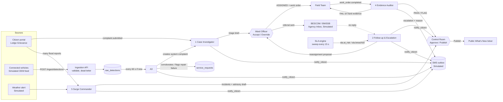

# CivicFlow agents

Five agents run on one shared runtime inside the FastAPI backend (`backend/app/agents/`). They **propose, and act only on safe, reversible steps**. Deterministic code enforces the rules: status transitions, permissions, SLA clocks and the append-only audit log. **No agent can reject or close a complaint.** Humans approve every decision that changes a citizen's outcome.

In the UI, agent output is always labelled **System Analysis**, **System Suggestion** or **Auto-check result**, and every run is in the **Agent Activity Log** (Control Room), with each tool call it made.

## How the agents fit together



## The shared runtime

`backend/app/agents/runtime/`

| File | What it does |
|---|---|
| `tools.py` | `@tool(name, description, schema)` registry. Tools are plain Python functions that query the DB or call adapters and return small JSON. Every call is logged as an `agent_steps` row. |
| `base.py` | `Agent`: name, system prompt, tool list, triggers, `max_steps` (8), `timeout_s` (30), Pydantic `output_model`, `fallback()` and `apply()`. |
| `loop.py` | The tool-use loop (below). |
| `notify.py` | Shared `notify_citizen(sr_id, event, extra)`: EN/KN templates, one outbox row per reporter (merged reporters keep getting updates), idempotent per event. |
| `registry.py` | Subscribes agents to bus events and scheduler jobs. |
| `../../adapters/llm.py` | LLM adapter: Anthropic Claude by default (`CIVICFLOW_LLM_MODEL`), optional Gemini (`LLM_PROVIDER=gemini`), plus the record/replay cache. |

```mermaid
sequenceDiagram
  autonumber
  participant Bus as Event bus / scheduler
  participant Loop as run_agent()
  participant LLM as Claude (or replay cache)
  participant Tools as Tool registry
  participant DB as agent_runs / agent_steps
  Bus->>Loop: event (e.g. complaint.submitted)
  Loop->>DB: start run (agent, trigger, input summary)
  alt no API key, timeout, error, refusal, invalid output, replay miss
    Loop->>Tools: rule-based fallback (steps logged as rule:...)
  else model available
    loop up to 8 steps
      Loop->>LLM: system prompt + tools + messages
      LLM-->>Loop: tool_use
      Loop->>Tools: invoke tool
      Tools-->>Loop: small JSON result
      Loop->>DB: agent_steps row (tool, args, result)
    end
    LLM-->>Loop: final JSON
    Loop->>Loop: validate with Pydantic (one retry on error)
  end
  Loop->>Loop: apply(output): deterministic side effects via transition()
  Loop->>DB: finish run (model or "rules", latency, output, rationale, confidence)
```

- **Fallback:** every agent has a rule-based `fallback()`. With no API key the whole system still works; the UI says "Rule-based analysis".
- **Record / replay:** `AGENT_MODE=live | record | replay`. Keys are per turn over the full message history, so replay needs the fixed demo seed (`DEMO_EPOCH`). A replay miss falls back to rules quietly.
- **Human override:** officers Accept or Override a System Suggestion; any staff member can record disagreement on a run (`POST /agent-runs/{id}/override`). The Activity Log shows who and why.

## The five agents

### 1. Case Investigator (fixes "routing is slow")

| | |
|---|---|
| Trigger | `complaint.submitted`, `complaint.reopened` |
| Tools | ward lookup (point in polygon), nearby assets, asset history, nearby open complaints, planned works, asset owner, sensitive places, vehicle detections nearby, SLA policy, officer workload, photo analysis |
| Output | `TriageBrief`: category, priority, department, ward, suggested officer, asset, duplicate + confidence, repeat failure, planned-work conflict, inter-agency referral, 3–5 rationale bullets, confidence |
| Acts alone | Queue placement; auto-merge of duplicates at ≥ 0.9 confidence; emergency keywords (EN + KN) → P1 and a Control Room alert; acknowledgement to the citizen; referral **draft** |
| Needs a human | Officer **Accept** (→ ASSIGNED, sends the referral) or **Override** with a reason; merges below 0.9 |
| Fallback | Point-in-polygon ward, category → department table, priority rules (sensitive place nearby, arterial road), radius/time duplicate check |
| Where in the UI | Officer case page → **System Analysis** panel (with **Steps taken**) |

### 2. Follow-up & Escalation (fixes "follow-up is poor")

| | |
|---|---|
| Trigger | `sla.at_risk` (75 % of SLA), `sla.breached`, agency follow-up due (every 24 SLA-hours). The 15-second SLA sweep is deterministic; the agent runs only when a case changes state. |
| Tools | case timeline, crew load, available crews (incl. next ward), material stock, referral status, agency follow-up, propose reassignment, material request, escalate, notify officer, notify citizen |
| Diagnosis | CREW_OVERLOAD, MATERIAL_OUT, AGENCY_PENDING, NOT_STARTED |
| Acts alone | Agency follow-ups; L2 escalation after 2 unanswered follow-ups; material requests; the written reason on breach escalations; honest delay messages to citizens |
| Needs a human | Reassignment (officer **Approve**), SLA pause / waiver |
| Rules in code | Escalation never resets the SLA clock; pauses only for approved reasons; second reopen → L2; L1–L4 on breach |
| Where in the UI | Officer queue → **Pending Reassignment Proposals**; Control Room → Dashboard → **Escalations** |

### 3. Road Hazard Sensing (data collection layer)

| | |
|---|---|
| Trigger | Every 60 s when new detections have arrived (or `POST /demo/run/sensing`) |
| Data | `POST /ingest/detections` (≤ 1000 records, `X-API-Key`, `Idempotency-Key`); validation (city boundary, not in the future, ≤ 30 days old, confidence 0–1, type mapping, de-duplication); personal data (VIN, rider, phone, trip) refused; every failure kept in `rejected_detections` |
| Tools | PostGIS `ST_ClusterDBSCAN` clustering (12 m), cluster stats, known features, nearby complaints, recent repairs, road class, create complaint, attach corroboration, flag repair failure, queue for review |
| Acts alone | Filters speed breakers, rail crossings and single-vehicle clusters; **creates** a complaint for strong clusters (≥ 3 distinct vehicles, confidence ≥ 0.8, enforced in code) with no complaint nearby; **corroborates** an open complaint within 25 m; flags a **repair failure** where a repair was verified in the last 30 days |
| Needs a human | Weak or ambiguous clusters → review queue (Confirm / Dismiss) |
| Where in the UI | Control Room → **Road Hazard Map**, review queue, **Data Sources** |

### 4. Evidence Auditor (proves the work was really done)

| | |
|---|---|
| Trigger | `work_order.completed` |
| Checks | Photo taken after assignment (EXIF time); GPS within the category radius (pothole 50 m); not a reused photo (perceptual hash against every stored image, incl. the job's before-photo); vision: issue fixed, same scene (skipped in rules mode); missing EXIF → "cannot verify" |
| Output | `AuditVerdict`: PASS / FLAG / FAIL, score 0–100, each check with detail, rationale |
| Acts alone | FAIL → **REWORK** only on hard evidence (GPS > 500 m away, reused photo, taken before assignment); the model cannot override that. Crews with 2+ FLAG/FAIL in 30 days → higher audit priority. |
| Needs a human | PASS and FLAG → Control Room **Approve** (→ VERIFIED) or Reject. Final approval is always human. |
| Where in the UI | Field Team job page (rework reason); Control Room → **Verification Queue** (photos, every check) |

### 5. Surge Commander

| | |
|---|---|
| Trigger | Every 20 s: ≥ 15 flood / drain / tree-fall reports in 60 SLA-minutes in one area, or an active weather alert plus ≥ 6 |
| Tools | recent complaints, DBSCAN grouping (1 km), weather alerts, crew availability, create / link incident, draft advisory (EN + KN), situation summary, notify citizens |
| Acts alone | Creates and names incidents ("Kengeri Underpass Waterlogging — 17 reports"), links reports (later ones within 1.2 km too), crew suggestion **as text**, advisory draft, the Commissioner's situation summary (refreshed every SLA-hour), tells every linked citizen |
| Needs a human | Control Room **Publish** (→ public "What's New" ticker); actual crew allocation |
| Where in the UI | Control Room → **Incidents** |

## What is real and what is simulated

| Part | Status |
|---|---|
| Agents, runtime, decision log, fallbacks, record/replay | Real |
| Workflow, SLA engine, escalation rules, audit log, scoping | Real |
| PostGIS ward lookup, clustering, radius queries | Real (ward polygons are approximate) |
| Photo EXIF, perceptual hash | Real; vision needs the model |
| Ingestion API, validation, dead letter | Real |
| Connected-vehicle (OEM) feed | **Simulated** (`simulator/sim.py`; no OEM data is public) |
| SMS / WhatsApp | **Simulated** (on-screen outbox) |
| BESCOM / BWSSB | **Simulated** (Agency Inbox page, played by the presenter) |
| Weather alerts, OTP login | **Simulated** |
