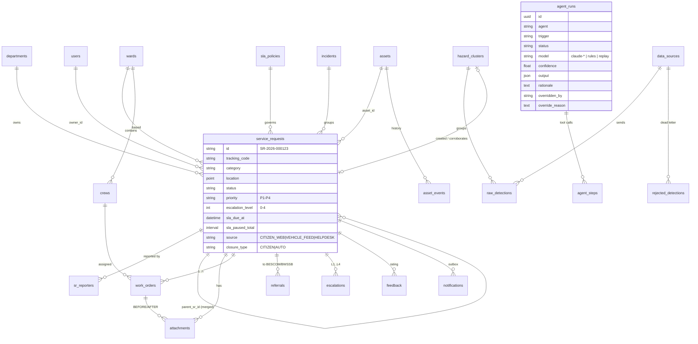
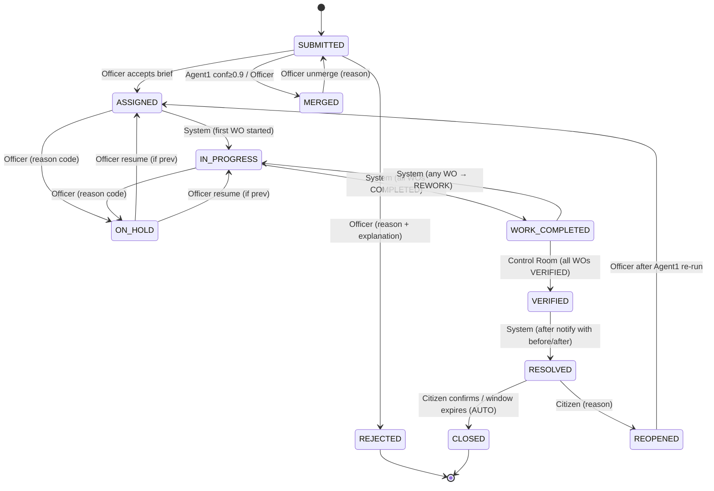
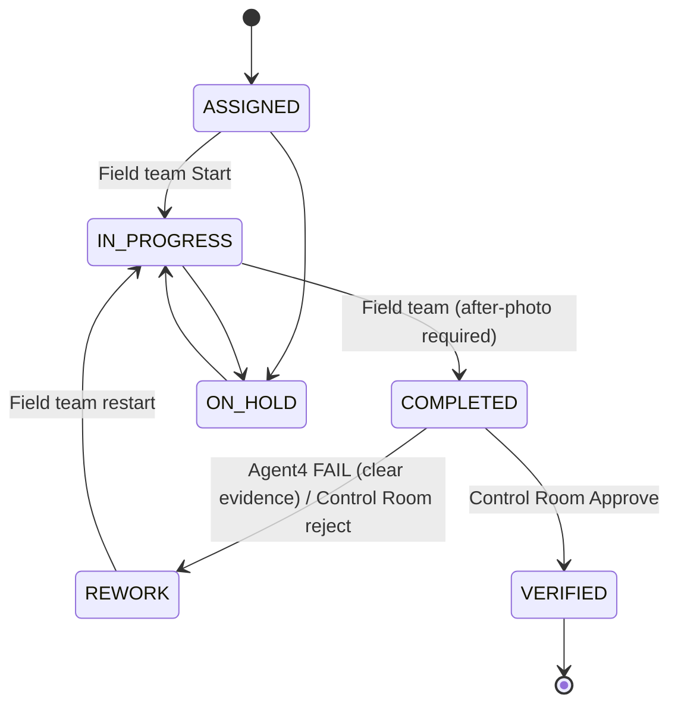

# CivicFlow — Build Plan (Step 0)

> Status: **DRAFT, awaiting approval.** Team: **2 people, 2 Claude Code machines (A and B).** 24 hours.
> Source brief: `docs/BRIEF.md` (paste the original brief there so both Claudes read the same spec).

---

## 1. The problem, in five lines

1. City complaints arrive constantly, and working out which ward, department or agency owns each one is done by hand, slowly.
2. Once routed, cases go quiet: nobody chases idle work orders or unresponsive agencies (BESCOM/BWSSB).
3. Citizens never find out what happened or why it's late, so trust drops and duplicate complaints pile up.
4. CivicFlow puts five agents on top of a deterministic workflow engine. They investigate, route, chase, verify and coordinate, and every step is logged and visible.
5. Agents only take safe, reversible actions. Humans make every decision that changes a citizen's outcome (accept, reject, verify, publish).

---

## 2. Architecture

```mermaid
flowchart TB
  subgraph Clients["web/ (React + Vite + TS) — Machine B"]
    CP[Citizen Portal<br/>EN + ಕನ್ನಡ]
    OC[Officer Console]
    FT[Field Team<br/>mobile web]
    CR[Control Room<br/>+ Activity Log + Hazard Map]
    AI[Agency Inbox<br/>simulated]
  end

  SIM[simulator/ container<br/>simulated OEM feed + rain scenario]

  subgraph API["backend/ FastAPI modular monolith — Machine A"]
    R[REST routers /api/v1]
    ING[ingestion]
    subgraph Domain
      WF[workflow<br/>transition table + transition()]
      SR[complaints] --- WO[work_orders]
      SLA[sla + clock TIME_SCALE]
      GEO[wards · assets · crews]
      NOTIF[notifications outbox]
      MEDIA[media StorageAdapter]
      AUD[audit + status_events<br/>append-only]
    end
    BUS[(Event bus<br/>in-process pub/sub<br/>+ events table)]
    SCH[APScheduler]
    subgraph AGENTS["agents/"]
      RT[Runtime: tool registry · Claude tool-use loop<br/>decision log · fallback · record/replay]
      A1[1 Case Investigator]
      A2[2 Follow-up & Escalation]
      A3[3 Road Hazard Sensing]
      A4[4 Evidence Auditor]
      A5[5 Surge Commander]
    end
    ADP[adapters: LLM · SMS outbox · weather · agency · storage]
  end

  DB[(PostgreSQL 16 + PostGIS)]
  FS[/media volume/]
  CLAUDE[[Anthropic API<br/>or replay cache]]

  Clients -->|JSON + cookie session| R
  SIM -->|X-API-Key| ING
  R --> Domain
  ING --> DB
  Domain --> BUS
  BUS --> AGENTS
  SCH --> AGENTS
  AGENTS -->|tools| Domain
  RT --> CLAUDE
  Domain --> DB
  MEDIA --> FS
```

**Key implementation decisions**

| Decision | Choice | Why |
|---|---|---|
| DB access | **Sync** SQLAlchemy 2.x + psycopg 3, FastAPI sync endpoints | Faster to write and debug in 24h. The agents call the sync `anthropic` SDK anyway. |
| Event bus | `bus.publish(name, payload)` writes to `events` **in the same transaction**. After commit, handlers run on a `ThreadPoolExecutor` (4 workers) with their own DB session. | Agents never block a request, and no event is lost on a crash before commit. The table works as a replayable log. |
| Geo | GeoAlchemy2 + Shapely. Geometry stored in SRID 4326; distances via `geography`; DBSCAN on `ST_Transform(geom, 32643)` (UTM 43N, metres) | `ST_ClusterDBSCAN` eps has to be in metres. |
| Auth | Seeded users, demo "OTP" shown on screen, signed HTTP-only cookie session (itsdangerous) | No real OTP, as the brief says. |
| Authorization | Every query goes through `scoped_*()` helpers in `backend/app/core/scope.py`. Field-team serializers have no phone field. | Scoping is tested, and nothing is left to the UI to hide. |
| Clock | `app.core.clock.now()` = `real_start + (real_now - real_start) * TIME_SCALE`, plus `clock.freeze()` / `clock.advance()` for tests and the demo | One clock everywhere. `make demo` can jump time. |
| Media | `LocalStorageAdapter` writes to `/media`; URLs are `/media/{id}?exp=&sig=` with an HMAC signature valid for 10 minutes | Short-lived signed URLs without S3. |
| Frontend types | `openapi-typescript` generates `web/src/api/schema.d.ts` from `/openapi.json` | Machine B can never drift from Machine A's API. |

---

## 3. Repo structure (ownership: **A** = Machine A, **B** = Machine B)

```
civicflow/
├── docker-compose.yml            A   db(postgis/postgis:16-3.4) · api · web · simulator
├── Makefile                      A   seed / demo / test / up / record  (+ scripts/*.ps1 for Windows)
├── .env.example                  A
├── README.md  PROGRESS.md        B   (both append to PROGRESS.md)
├── docs/  BRIEF.md BUILD_PLAN.md AGENTS.md API.md DEMO_SCRIPT.md     B writes, A reviews
├── backend/                      A ONLY
│   ├── pyproject.toml
│   ├── alembic/                  A ONLY. B never creates migrations
│   ├── app/
│   │   ├── main.py  config.py
│   │   ├── core/   db.py clock.py bus.py scope.py security.py errors.py
│   │   ├── models/ (one file per domain; single Base)
│   │   ├── schemas/ (Pydantic API models = the contract with B)
│   │   ├── modules/
│   │   │   ├── auth/ complaints/ workflow/ work_orders/ sla/ wards/ assets/
│   │   │   ├── crews/ notifications/ media/ audit/ ingestion/ incidents/
│   │   │   ├── referrals/ kpis/ agency_inbox/
│   │   │   └── each: router.py service.py
│   │   ├── adapters/  llm.py storage.py sms.py weather.py agency.py
│   │   ├── agents/
│   │   │   ├── runtime/  base.py tools.py loop.py cache.py runlog.py notify.py registry.py
│   │   │   ├── investigator/  agent.py tools.py prompt.md fallback.py schema.py
│   │   │   ├── followup/  sensing/  auditor/  surge/   (same layout)
│   │   ├── scheduler.py
│   │   └── seed/  build.py  data/*.json|geojson  fixtures/photos/*.jpg
│   ├── agent_cache/              recorded LLM responses (committed for the demo)
│   └── tests/
├── simulator/                    B   own container: sim.py scenarios/ (only talks HTTP to the API)
└── web/                          B ONLY
    ├── src/
    │   ├── api/ (generated schema + fetch client)
    │   ├── frame/ TopStrip Header Crest.svg NavBar Ticker Footer ProtoBanner Breadcrumbs
    │   ├── ui/    Table(paginated, S.No., Export) Fieldset Captcha Timeline SlaBadge StatusTag
    │   ├── pages/citizen/ Home Lodge Ack Track
    │   ├── pages/officer/ Queue CaseDetail SystemAnalysis Reassignments
    │   ├── pages/field/   MyJobs JobDetail
    │   ├── pages/control/ Dashboard ActivityLog HazardMap Incidents Verification Escalations
    │   ├── pages/agency/  Inbox
    │   ├── i18n/ en.json kn.json
    │   └── styles/ tokens.css base.css
    └── e2e/ happy-path.spec.ts
```

---

## 4. ER diagram (main tables)



Generic append-only tables, with no FKs drawn above: `status_events`, `audit_log`, `events`. A Postgres trigger raises an exception on UPDATE and DELETE for `audit_log` and `status_events`. Tests reset data with `TRUNCATE`, which the trigger doesn't block.

---

## 5. State diagrams

### 5.1 Complaint (Service Request)



### 5.2 Work order



**Implementation:** `workflow/table.py` holds `TRANSITIONS: list[Transition(obj, from_, to, actors: set[ActorKind|Role], requires: list[str], side_effect: str|None)]`.
`transition(session, obj, to, actor, **fields)` does five things. (1) It looks up the row and raises `InvalidTransition` if there isn't one. (2) It checks the actor's role and that the required fields are present. (3) It sets the state. (4) It writes a `status_events` row and an `audit_log` row (before/after JSON). (5) It calls `bus.publish(f"{obj}.{to.lower()}")`. The SLA clock pauses or resumes inside `transition()` on entering or leaving `ON_HOLD` (approved reasons only). SR side effects such as "all WOs completed → SR WORK_COMPLETED" are triggered from WO transitions inside the same function, and they never bypass it. Escalation is a separate `escalate()` service, never a state, and it **never touches `sla_due_at`**.

---

## 6. The agents

All agents subclass `Agent` (see §7). In the UI, agent output is always labelled **"System Analysis"**, **"System Suggestion"** or **"Auto-check result"**.

### Agent 1: Case Investigator
| | |
|---|---|
| **Trigger** | `complaint.submitted`, `complaint.reopened` |
| **Tools** | `get_ward_for_location`, `find_nearby_assets`, `get_asset_history`, `find_nearby_open_complaints`, `get_planned_works`, `get_asset_owner`, `get_sensitive_places_nearby`, `get_vehicle_detections_nearby`, `get_sla_policy`, `get_officer_workload`, `analyze_photo` (vision), `notify_citizen` |
| **Output** | `TriageBrief{category, priority, department_id, ward_id, suggested_officer_id, asset_id?, duplicate_of?, duplicate_confidence, repeat_failure, repeat_failure_note?, planned_work_conflict?, interagency_referral?{agency, reason}, rationale: list[str] (3–5), confidence}` |
| **Acts alone** | Sets ward, department and owner (the queue placement). Auto-merges at conf ≥ 0.9 via `transition(MERGED)` with actor AGENT, adds an `sr_reporters` row and bumps `reporter_count`. Emergency keywords (EN + ಕನ್ನಡ list) → P1 + `control_room.alert` event. Sends the acknowledgement via `notify_citizen`. Creates a `referral` row in **DRAFT**. |
| **Needs human** | Officer **Accept** (→ ASSIGNED, sends the referral) or **Override** (reason required, stored on `agent_runs`). Merge suggestions below 0.9. |
| **Fallback** | Point-in-polygon ward, category→department table, priority rule table (sensitive place within 200 m → +1 priority; arterial road → +1), duplicate check on same category, radius and 72 h, with a trigram similarity score on the text. |
| **Demo moment** | Streetlight complaint at the Kengeri bus stand → the tool calls show that pole `STREETLIGHT-W12-00871` failed twice in 60 days, there are 2 open streetlight complaints within 150 m, and the owner is BESCOM → "Likely feeder fault; refer to BESCOM; P2 because of bus stand." Also: the citizen pothole near the school is auto-merged twice, reporter count 3. |

### Agent 2: Follow-up & Escalation
| | |
|---|---|
| **Trigger** | Scheduler every 60 s (real time; SLA uses the scaled clock), `referral.created` |
| **Tools** | `get_case_timeline`, `get_crew_load`, `find_available_crews`, `check_material_stock`, `get_referral_status`, `send_agency_followup`, `propose_reassignment`, `raise_material_request`, `escalate`, `notify_officer`, `notify_citizen` |
| **Output** | `FollowupDecision{sr_id, diagnosis: enum[CREW_OVERLOAD, MATERIAL_OUT, AGENCY_PENDING, UNASSIGNED, OTHER], explanation, actions_taken[], proposal?, citizen_message}` |
| **How it runs** | A deterministic sweep (`sla.sweep()`) recomputes SLA state for each case and finds the **cases that need attention**: just crossed AT_RISK, just BREACHED, or a referral due for follow-up. The LLM agent runs **only on those**, once per state change and not every tick. That keeps cost and the log manageable. |
| **Acts alone** | Agency follow-ups every 24 SLA-hours. After 2 follow-ups with no reply → escalate to the zonal officer. Material requests. On breach the rule engine calls `escalate(level+1)` and the agent writes `reason_summary`. Honest citizen notifications. |
| **Needs human** | Reassignment (`reassignment_proposals` row, officer Approve), SLA pause or waiver |
| **Rules (code)** | Escalation never resets the SLA. Pause only for approved reasons. A second reopen → automatic L2. Cap at L4. |
| **Fallback** | Diagnosis by template: crew open WOs > capacity → CREW_OVERLOAD; required material qty = 0 → MATERIAL_OUT; referral open → AGENCY_PENDING. Messages from templates. |
| **Demo moment** | (a) BESCOM referral: follow-ups #1 and #2 go to the Agency Inbox, then an L2 escalation "Awaiting BESCOM feeder repair; followed up twice (date, date); not municipal inaction". (b) The pre-seeded pothole WO on crew W12-B hits 75%: crew at 6/4 capacity, cold-mix stock 0 → "Crew W13-B free 1.2 km away; reassign?" plus a material request. Officer approves and the citizen is told the honest reason. |

### Agent 3: Road Hazard Sensing
| | |
|---|---|
| **Trigger** | Scheduler every 2 real minutes (or `POST /api/v1/admin/run/sensing` for the demo) if new `raw_detections` have arrived since the last run |
| **Tools** | `cluster_detections`, `get_cluster_stats`, `check_known_features`, `find_nearby_open_complaints`, `get_recent_repairs`, `get_road_class`, `create_system_complaint`, `attach_corroboration`, `flag_repair_failure`, `queue_for_review` |
| **Output** | `SensingReport{clusters: [{cluster_id, decision: CREATE|CORROBORATE|REPAIR_FAILURE|FILTERED|REVIEW|IGNORE, reason, sr_id?}]}` |
| **How it runs** | Clustering and the filters are **deterministic SQL**, done before the LLM sees anything. The agent then decides only on clusters that changed. One run handles a batch of up to 10 clusters, which avoids 15 separate LLM runs. |
| **Acts alone** | Creates a system complaint (`source=VEHICLE_FEED`) when a cluster is strong (≥ 3 distinct vehicles, avg conf ≥ 0.8) and no complaint is within 25 m. That complaint goes through Agent 1. Corroboration within 25 m ("Confirmed by 7 connected vehicles", priority score up). Repair-failure flag when a repair was VERIFIED within 30 days at that spot. |
| **Needs human** | Weak or ambiguous clusters go to the review queue |
| **Fallback** | The same thresholds as pure rules |
| **Demo moment** | Map: 5 speed breakers visibly greyed out as "Filtered: known speed breaker". The school pothole complaint gets "Confirmed by 7 vehicles". A new complaint appears on Mysore Road (arterial) that no citizen filed. The recently repaired spot is flagged against crew W13-A. |

### Agent 4: Evidence Auditor
| | |
|---|---|
| **Trigger** | `work_order.completed` |
| **Tools** | `get_photo_metadata`, `get_work_order`, `distance_m`, `compare_with_all_photos`, `vision_compare`, `get_crew_audit_history` |
| **Output** | `AuditVerdict{verdict: PASS|FLAG|FAIL, score 0–100, checks:[{name, passed: bool|null, detail}], rationale}` |
| **Checks** | (1) EXIF time > WO assigned_at. (2) EXIF GPS within the category radius (pothole 50 m). (3) pHash Hamming distance ≥ 8 vs every other stored image. (4) Vision: issue fixed and same scene. Missing EXIF → `passed=null` "unverifiable" → at best FLAG. |
| **Acts alone** | FAIL with hard evidence (GPS > 500 m, or a reused photo) → `transition(WO, REWORK, actor=AGENT, reason=…)`, field team notified. Crews with ≥ 2 FLAG/FAIL in 30 days → `audit_priority=HIGH` badge. |
| **Needs human** | PASS and FLAG → Control Room **Approve** (→ VERIFIED) or Reject. The final approval is always human. |
| **Fallback** | Checks 1–3 as rules; vision `skipped` |
| **Demo moment** | The first after-photo is a fixture with EXIF GPS 2.1 km away → FAIL "Photo location 2.1 km from complaint site (limit 50 m)" → REWORK, with the reason on the field team screen. The second photo → PASS (score 92). Control Room approves. |

### Agent 5: Surge Commander (kept small)
| | |
|---|---|
| **Trigger** | Rule check every scheduler tick: ≥ 15 flood/drain/waterlogging/tree-fall complaints within 2 km and 60 SLA-minutes, **or** an active weather alert plus rate > 2× baseline |
| **Tools** | `get_recent_complaints`, `cluster_complaints` (reuses the Agent 3 DBSCAN helper), `get_weather_alerts`, `create_incident`, `link_to_incident`, `get_crew_availability`, `draft_public_advisory`, `write_situation_summary`, `notify_citizen` |
| **Output** | `SurgePlan{incidents:[{name, sr_ids, severity, crew_suggestion}], advisory_draft, situation_summary}` |
| **Acts alone** | Creates incidents, links SRs, notifies all linked citizens, writes the drafts, refreshes the summary every SLA-hour |
| **Needs human** | Control Room **Publish** advisory → appears in the public ticker. Actual crew allocation. |
| **Fallback** | Radius grouping and named templates ("{area} Waterlogging — {n} reports") |
| **Demo moment** | `make rain` → 25 complaints → 2 incidents: "Kengeri Underpass Waterlogging — 17 reports" and "RR Nagar Arch Drain Overflow — 8 reports". Advisory drafted → Publish → ticker shows "NEW Avoid Kengeri underpass; crews deployed". |

### Shared tool `notify_citizen(sr_id, event, extra)`
Template lookup by `(event, language)` from `notifications/templates.py` (EN + KN) fills in the facts. The LLM may only polish wording in **live** mode, behind a length cap. The tool writes one outbox row **per reporter** in `sr_reporters`, so merged reporters keep getting updates. It is idempotent per (sr, event, extra hash), which stops spam from repeated ticks.

---

## 7. Shared Agent Runtime

```
backend/app/agents/runtime/
  tools.py     @tool(name, description, schema) → ToolSpec; registry dict; invoke(name, args, ctx) with ctx.session, ctx.run_id
  base.py      class Agent: name, system_prompt, tools: list[str], triggers, max_steps=8, timeout_s=30,
               output_model: type[BaseModel], def build_input(event)->dict, def fallback(input)->BaseModel,
               def apply(output, ctx) (deterministic side effects that run AFTER validation)
  loop.py      run_agent(agent, event) — the loop below
  llm.py       LLMAdapter: live client | RecordingClient | ReplayClient (selected by AGENT_MODE)
  cache.py     key = sha256(agent + canonical_json(messages + tool names + model)); files agent_cache/<agent>/<key>.json
  runlog.py    start_run / log_step / finish_run / mark_override
  notify.py    notify_citizen tool
  registry.py  subscribes each agent's triggers to the bus; scheduler jobs
```

**Run loop (`run_agent`)**

```
run = start_run(agent, trigger, input_summary)
if no API key and AGENT_MODE != replay:   → fallback
messages = [user: agent.render_input(input)]
deadline = now + timeout_s
for step in range(max_steps):
    resp = llm.create(model, system, tools=[specs], messages, ...)   # replay may return CacheMiss → fallback
    if resp.stop_reason == "tool_use":
        for each tool_use block: result = invoke(...) (errors returned as {"error": ...}, not raised)
                                 log_step(run, tool, args, summarize(result))
        messages += [assistant: resp.content, user: tool_results]
        continue
    final = extract JSON from the final text (the agent is told to answer with only JSON matching the schema)
    try:   out = agent.output_model.model_validate(final)
    except ValidationError: if not retried: append "Fix: <errors>" and loop once more; else → fallback
    break
else: → fallback (step limit)
agent.apply(out, ctx)            # side effects run once, from validated output (except tools that act directly)
finish_run(run, status, model or "rules"/"replay", latency, out, rationale, confidence)
```

- Timeout: checked between steps, plus `timeout` on the HTTP client. Any exception → fallback, `status=FALLBACK`, error stored.
- Fallback runs log their deterministic checks as `agent_steps` too (tool=`rule:<name>`), so the Activity Log never looks empty without an API key.
- **Replay determinism:** cache keys include tool results, so the seed uses **fixed IDs and a fixed demo clock origin** (`DEMO_EPOCH=2026-11-05T09:00:00+05:30`). A cache miss in replay mode falls back to rules quietly, so the demo never breaks.
- Overrides: `POST /agent-runs/{id}/override {reason}` → `overridden_by`, `override_reason`, shown in the Activity Log "Overridden?" column.

---

## 8. Seed data plan

**Geography:** 4 fictional wards drawn as approximate polygons over the real Kengeri / RR Nagar area (labelled "approximate demo boundaries"): **W12 Kengeri**, **W13 Rajarajeshwari Nagar**, **W14 Kengeri Satellite Town**, **W15 Hemmigepura**. Zones: West-1, West-2. City boundary = their union plus a buffer (used by ingestion validation).

| Data | Volume | Demo purpose |
|---|---|---|
| Departments | 6: Roads, Street Lighting, SWM (garbage), Storm Water Drains, Water/UGD liaison, Parks/Trees | Category→department routing |
| Users | citizen1 (ಕನ್ನಡ), citizen2, citizen3, officer.w12, officer.w13, zonal.west, field.w12a, field.w12b, field.w13a, field.w13b, control (EE/Commissioner) | Login page lists them. OTP shown on screen. |
| Assets | ~120 streetlights (`STREETLIGHT-W12-00871` …), ~30 drains, 10 transformers (BESCOM), 8 water mains (BWSSB) | Ownership plus history lookups |
| Asset history | Pole **00871**: repairs 48 d and 19 d ago. 2 open streetlight complaints within 150 m. | **Demo 4**: repeat failure → BESCOM |
| Sensitive places | ~25: schools, hospitals, markets, Kengeri TTMC bus stand, metro station | **Demo 1**: school near pothole, bus stand near pole |
| Known road features | 5 speed breakers, 1 rail crossing | **Demo 3**: filtered on the map |
| Road segments | Mysore Road and Uttarahalli Main as ARTERIAL; ~20 local roads | Priority boost and the "unreported arterial pothole" |
| Planned works | 2: Metro Phase-2 viaduct works (BMRCL) along Mysore Rd; BWSSB pipeline on 80 ft road | `planned_work_conflict` shows up in briefs |
| Crews | W12-A (2/4 load), **W12-B (6/4, overloaded)**, W13-A, **W13-B (0/4, 1.2 km from the job)** | **Demo 6** reassignment |
| Inventory | `cold_mix_bitumen=0`, `led_driver_40w=0`, others stocked | **Demo 6** material out → request. Fits the "LED drivers out since 3 Nov" story. |
| Pre-seeded active job | Pothole SR on W12-B, SLA started so it sits at ~70% at `DEMO_EPOCH` | Crosses 75% about 1 minute into the demo |
| Recently repaired spot | Pothole WO VERIFIED 10 days ago by W13-A on Uttarahalli Rd | **Demo 3** repair-failure flag |
| Historical SRs | ~250 over 90 days, mostly CLOSED (~15% AUTO, ~6% reopened, some breaches) | Believable KPIs: total vs unique, SLA %, reopen rate, auto vs citizen closure |
| SLA policies | category × P1–P4 (e.g. open manhole P1 4 h; pothole arterial P2 5 d; streetlight P3 7 d). Verification window 24 h P1, 7 d otherwise. | SLA countdowns |
| Fixture photos | `pothole_before.jpg`, `after_far.jpg` (EXIF GPS 2.1 km away), `after_good.jpg` (EXIF at site, after assignment), `after_reused.jpg` (copy of another job's photo), `streetlight.jpg`, `noexif.jpg` | **Demo 5** plus Auditor tests. EXIF is rewritten with `piexif` at seed time relative to `DEMO_EPOCH`. |
| Data source | `oem-sim` with an API key from `.env` | Simulator auth |

`make demo` = reset DB → seed → freeze the clock at `DEMO_EPOCH` with `TIME_SCALE=60` → print the logins and the 8 demo steps.

---

## 9. Task split (2 people, 2 Claudes)

**Hard rule:** Machine A owns `backend/` (including Alembic and seed). Machine B owns `web/`, `simulator/` and `docs/`. Neither edits the other's folder. Contract changes go through `backend/app/schemas/` and `docs/API.md`.

| Hours | Checkpoint | **Machine A: backend + agents** | **Machine B: frontend + simulator + docs** |
|---|---|---|---|
| 0–1.5 | **C1a foundation** | docker-compose, Makefile, `.env.example`, all models + migration 001, `clock`, `bus`, transition table + `transition()` + tests, auth endpoints, **API stubs returning seed-shaped data**, push | Vite scaffold, `tokens.css`, the full government frame (strip, crest SVG, header, nav, ticker, footer, banner, breadcrumbs), Table/Fieldset/Captcha components, i18n setup |
| 1.5–7 | **C1b core** | Seed (§8), complaints, work orders, media + EXIF, SLA engine, scoping, notifications outbox, KPIs endpoint | Home, Lodge (Leaflet pin, photo), Ack slip, Track (timeline, before/after, confirm/reopen/rate), Login, Officer queue + case detail, Field team screens. Wired to the real API as it lands. |
| 7–9 | **C2** | Agent runtime + Agent 1 + `notify_citizen` + agent-runs API | System Analysis panel (brief, rationale, steps, Accept/Override), Activity Log table + drill-down |
| 9–16 | **C3** | Agent 4 → Agent 3 + ingestion API → Agent 2 → Agent 5 | **Simulator** (written against the ingestion contract in §10/API.md), Control Room panels, Hazard Map (clusters, raw dots, filtered), Verification queue, Incidents + Publish, Escalations, Agency Inbox, Reassignment approvals, Kannada strings |
| 16–19 | **C4 integration** | Run the demo story and fix backend bugs | Run the demo story, fix UI, Playwright test |
| 19–21 | **C5 hardening** | pytest green, `AGENT_MODE=record` the demo, commit the cache. **Freeze at 21.** | Accessibility pass, mobile Field screens, README |
| 21–24 | **C6** | Backup recording support, sleep in shifts | `docs/AGENTS.md` (Mermaid), `DEMO_SCRIPT.md`, backup video |

Git: one GitHub repo, `main` only, small commits, `git pull --rebase` before each push. The folder split means conflicts should only show up in `PROGRESS.md`.

---

## 10. Initial API surface (B mocks against this until A ships it)

```
POST /api/v1/auth/login {username} → {otp_demo}      POST /api/v1/auth/verify {username, otp} → cookie
GET  /api/v1/me
POST /api/v1/complaints (multipart: fields + photo)  → AckSlip
GET  /api/v1/complaints/track?no=&code=               → TrackView (timeline in plain words, photos)
POST /api/v1/complaints/{id}/confirm {rating, comment} | /reopen {reason}
GET  /api/v1/officer/queue?status=&priority=&page=    (ward-scoped)
GET  /api/v1/complaints/{id}                           → detail + latest TriageBrief + run steps
POST /api/v1/complaints/{id}/accept | /override {reason, changes} | /hold {reason_code} | /resume | /reject
POST /api/v1/complaints/{id}/work-orders {crew_id, scope, root_cause, est_cost_inr, before_photo}
GET  /api/v1/reassignments?status=PENDING   POST /api/v1/reassignments/{id}/approve
GET  /api/v1/field/jobs   GET /api/v1/field/jobs/{id}   POST .../start | .../photos (kind) | .../complete
GET  /api/v1/control/dashboard (KPIs, P1 queue, breaches, escalations)
GET  /api/v1/control/verification   POST /api/v1/work-orders/{id}/approve | /reject {reason}
GET  /api/v1/agent-runs?agent=&page=   GET /api/v1/agent-runs/{id} (steps)
GET  /api/v1/hazards/map?layers=raw,clusters,complaints   GET /api/v1/data-sources
GET  /api/v1/incidents   POST /api/v1/incidents/{id}/publish   GET /api/v1/public/ticker
GET  /api/v1/agency/inbox?agency=   POST /api/v1/agency/referrals/{id}/reply {status, message}
GET  /api/v1/public/stats   GET /api/v1/wards (geojson)
POST /api/v1/ingest/detections (X-API-Key, Idempotency-Key, ≤1000)   POST /api/v1/ingest/detections/csv
POST /api/v1/demo/clock/advance {hours}   POST /api/v1/demo/run/{agent}   (demo mode only)
```

---

## 11. Real vs simulated

| Component | Status |
|---|---|
| Workflow engine, SLA, escalation rules, audit log, scoping | **Real** |
| PostGIS ward lookup, radius queries, DBSCAN clustering | **Real** (approximate ward polygons) |
| Agents with Claude tool use, decision log, fallback | **Real** (replay cache for the demo) |
| Photo EXIF, perceptual hash, vision check | **Real** (on fixture photos) |
| Ingestion API, validation, dead-letter | **Real** |
| Connected-vehicle OEM feed | **Simulated** (documented contract; no OEM data is public) |
| SMS / WhatsApp | **Simulated** (on-screen outbox) |
| OTP login | **Simulated** (OTP shown on screen) |
| BESCOM / BWSSB responses | **Simulated** (Agency Inbox page, played by the presenter) |
| Weather alerts | **Simulated** adapter |
| Ward boundaries, assets, crews, inventory, history | **Synthetic** seed data |

---

## 12. Risks, and where the brief is wrong or too big (blunt)

1. **Scope vs 2 people.** The brief sizes itself for 3–4 people. With 2, the real budget is about 16 productive hours each. My planned cuts, decided now rather than at hour 18:
   - Agent 5: no LLM for crew suggestions; text template only. LLM only for the advisory and summary.
   - CSV ingestion endpoint: last thing built, cut first.
   - Export buttons: one shared CSV component, used only on the queue and the Activity Log.
   - Charts: one KPI bar chart, nothing else.
   - Kannada: citizen pages only (as the brief says), with machine-assisted translation **reviewed by one of you**.
2. **Record/replay keyed by (agent, input) doesn't work** for multi-turn tool use, because each turn includes tool results. I key per turn on the full message history. That only replays if the seed is byte-deterministic (fixed IDs, fixed clock). A change to seed or prompt after recording invalidates the cache, so **re-record after the last change at hour 21**.
3. **Running Agent 2 every minute on every case** would cost a lot and flood the Activity Log. I changed it to deterministic detection plus an LLM run only on state changes (§6). Same behaviour, about 100× fewer calls.
4. **Running Agent 3 per cluster** has the same problem, so it runs batched.
5. **Vision needs real-looking photos.** Take 4–6 phone photos of a real pothole (before and after, or two different potholes) and a streetlight near SJBIT **before hour 9**. I'll rewrite their EXIF. Stock photos risk licensing problems, and generated ones look fake to judges.
6. **Windows:** `make` needs `choco install make` or Git Bash. I'll also ship `scripts/*.ps1`. Docker Desktop with WSL2 must work on both machines. **Check this in the first 15 minutes.** PostGIS image pulls are about 600 MB.
7. **Live API dependence:** demo in `replay`. With no key at all, everything still works on rules (pytest enforces this).
8. **Auto-merge inside SUBMITTED** races the officer: the agent may merge after an officer has opened the case. `transition()` rechecks the state under `SELECT … FOR UPDATE`, so a stale agent action fails cleanly.
9. **New dependencies not in the brief** (need your OK): `geoalchemy2`, `shapely`, `psycopg[binary]`, `itsdangerous`, `httpx`, `rapidfuzz` (duplicate text similarity), `openapi-typescript` (dev), `react-leaflet`. Alternatively, I can use plain Leaflet through a small hook, which I'm fine with.
10. **The Playwright E2E** depends on photo upload with EXIF fixtures and on agents in replay/rules mode. It will run with `AGENT_MODE=rules` so it's deterministic.
